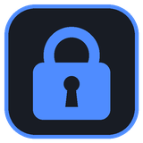
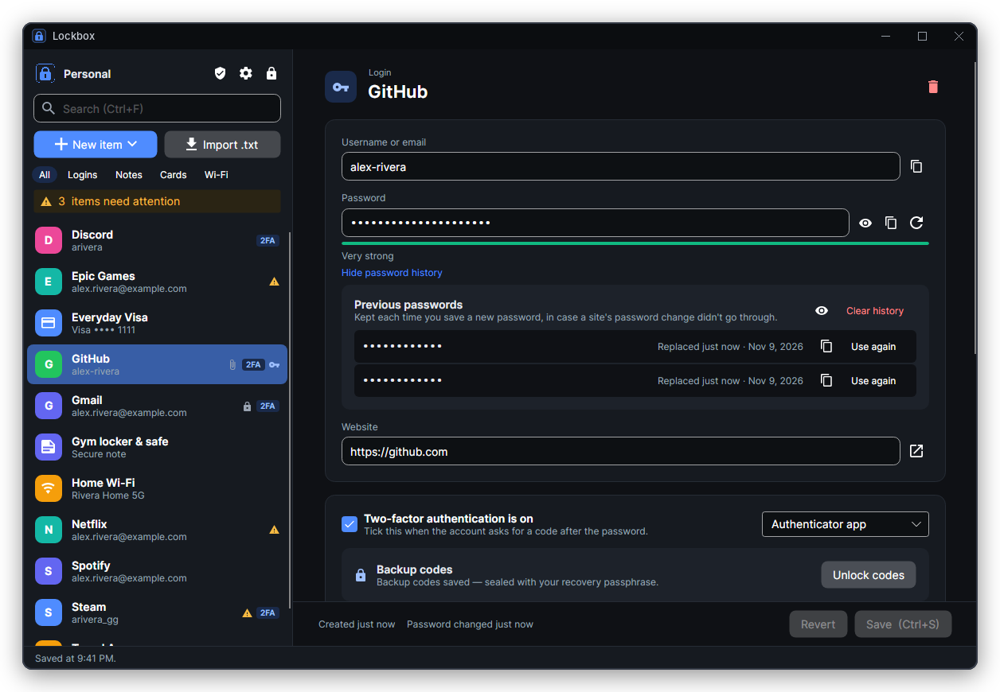
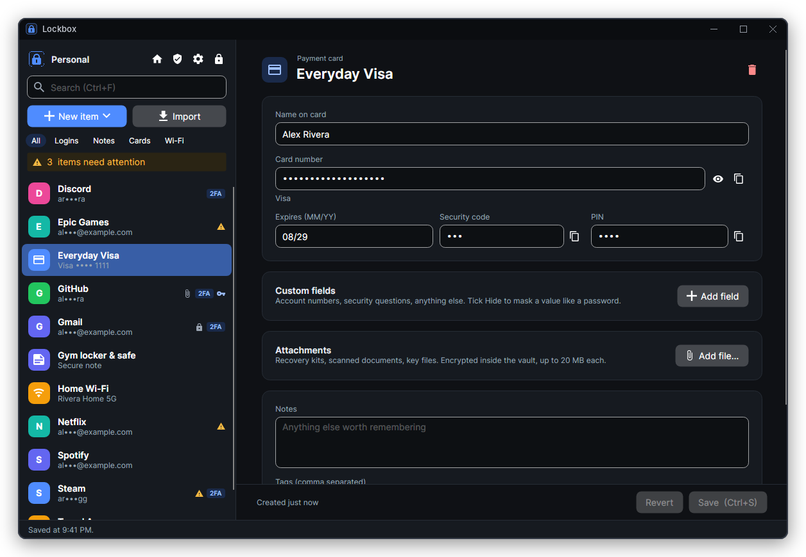
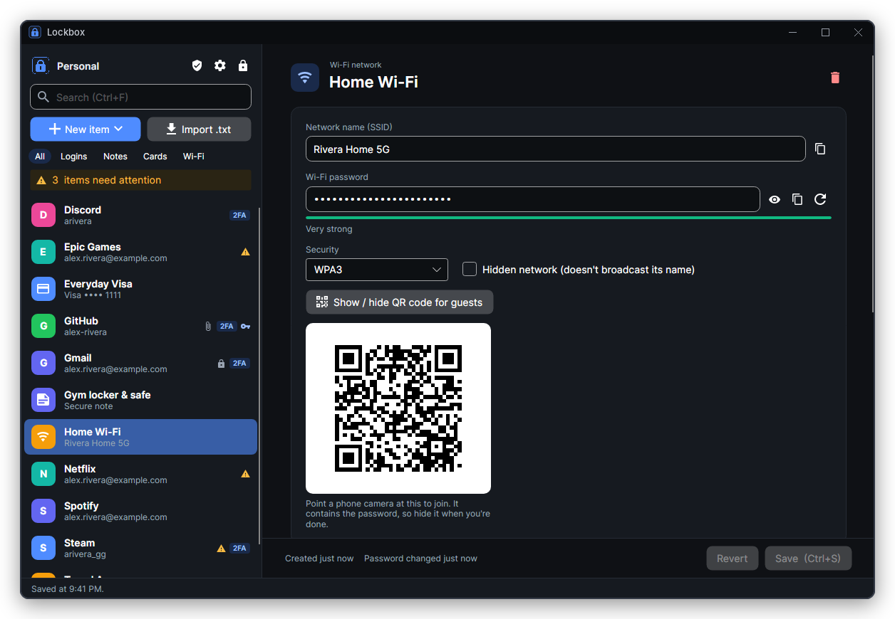
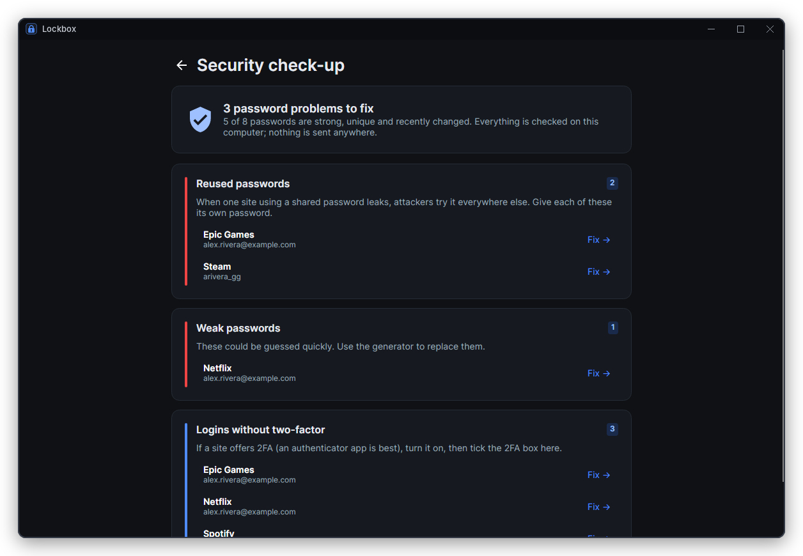
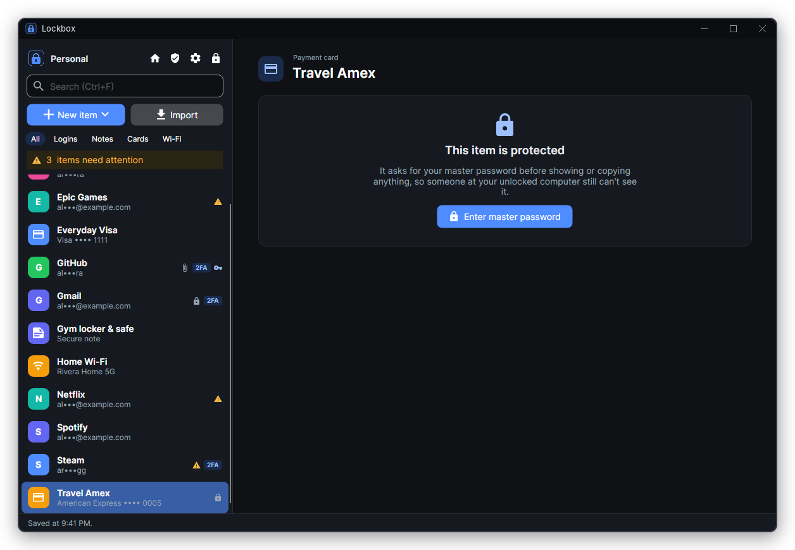
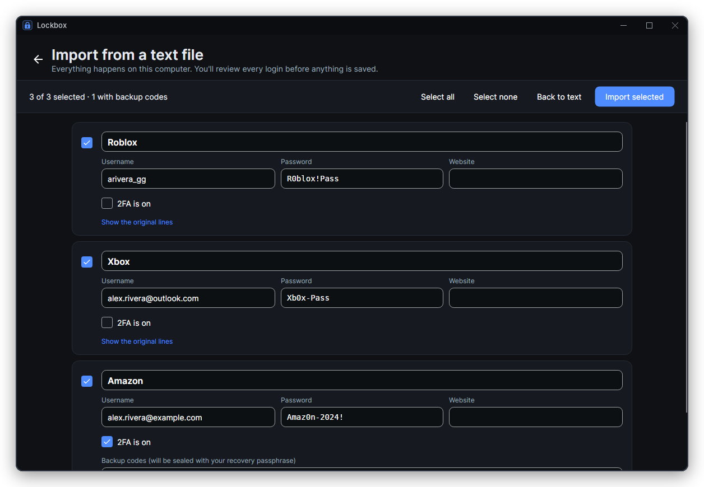
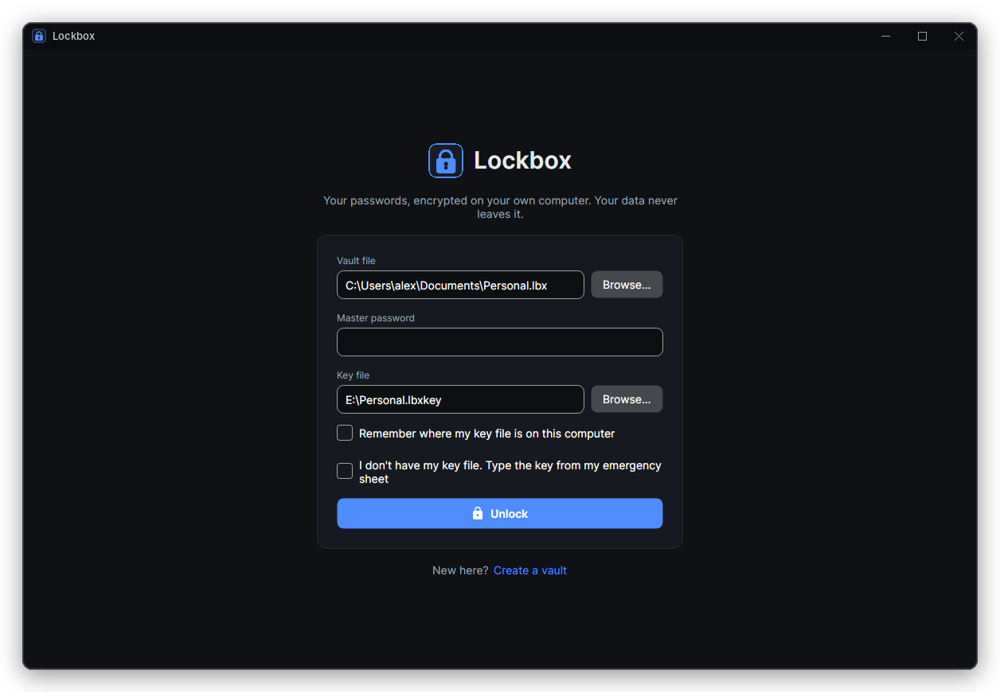

  

<h1 align="center">Lockbox</h1>

  <b>Your passwords, locked on your own computer.</b> 
  A password manager with no cloud, no account and no subscription.

  
  
  

  

## Why Lockbox?

Most password managers keep your vault on their servers. Lockbox keeps it in **one encrypted file that you own**, on your computer or in your own OneDrive or Google Drive folder.

Opening it takes **two things**: your master password and a small **key file** that works like a physical key, ideally kept on a USB stick. Someone who steals the vault file gets nothing without both. Your passwords are never sent anywhere.

It's for anyone who's been keeping passwords in a text file, a notes app or their head, and wants something safer that they fully control.

## A closer look

<table>
  <tr>
    <td width="50%" valign="top">
      
      
<b>More than passwords.</b> Keep logins, payment cards, Wi‑Fi networks and secure notes, plus custom fields and encrypted file attachments on any item.

    </td>
    <td width="50%" valign="top">
      
      
<b>Share Wi‑Fi in one tap.</b> Show a QR code and guests join by pointing their phone camera at it. No more reading passwords out loud.

    </td>
  </tr>
  <tr>
    <td width="50%" valign="top">
      
      
<b>Security check-up.</b> Finds reused, weak and old passwords and logins without two-factor, and lists them in the order to fix them.

    </td>
    <td width="50%" valign="top">
      
      
<b>Extra-protected items.</b> Mark your email, bank or cards so they need your master password again, even while Lockbox is open.

    </td>
  </tr>
  <tr>
    <td width="50%" valign="top">
      
      
<b>Bring your old passwords.</b> Import from Chrome, Edge, Firefox, Safari, another password manager or the text file you've been using. Review every login, then let Lockbox shred the original.

    </td>
    <td width="50%" valign="top">
      
      
<b>Two keys to get in.</b> Master password plus key file. Lost the key file? Type it in from the emergency sheet you printed.

    </td>
  </tr>
</table>

## Everything it does

**Keeps your stuff**

- Logins with a "2FA is on" checkmark, secure notes, payment cards and Wi‑Fi networks
- Custom fields (account numbers, security questions) and encrypted attachments (recovery kits, scans)
- Backup codes behind a second, separate passphrase
- Password history, so you can recover the old password if a site's change didn't go through

**Keeps you safe**

- Opens on a Home screen with nothing private on it, and partly hides usernames in the list (ty•••@example.com), so people nearby see nothing useful
- Locks itself when you step away, lock Windows or put the computer to sleep
- Copied passwords disappear from the clipboard after 20 seconds and stay out of Windows clipboard history
- Invisible in screenshots and screen sharing (Discord, OBS, Teams)
- Warns you if an older copy of your vault ever replaces a newer one
- Strong password and passphrase generator with a real strength meter
- Only one copy runs at a time, so two windows can never save over each other

**Stays out of your way**

- **Browser extension** for Chrome, Edge, Brave and Firefox: a Lockbox button in sign-in boxes, offers to save new and changed passwords, and strong passwords on sign-up pages. It talks only to Lockbox on your computer and ignores look-alike sites ([how it works](docs/BROWSER.md))
- **Auto-type:** press Ctrl+Alt+A on a sign-in page and Lockbox types your username and password, no clipboard involved (Windows, turn it on in Settings)
- Imports from Chrome, Edge, Brave, Firefox, Safari, Bitwarden, 1Password, LastPass, KeePassXC, Dashlane and Proton Pass
- Fast search, filters and keyboard shortcuts (Ctrl+F, Ctrl+C, Ctrl+B…)
- More than one vault? Switch from the recent vaults list on the unlock screen
- Updates itself, and only installs updates signed by the developer
- Export anytime: an encrypted backup, or a file you can import into Bitwarden

## Get started

1. **Download** `Lockbox-win-Setup.exe` from the [latest release](https://github.com/TylerJayP/Lockbox/releases/latest) and run it. Windows may say *"Windows protected your PC"* because the installer isn't code-signed. Click **More info → Run anyway**. This only happens once; updates install themselves after that.
2. **Create a vault.** Let Lockbox generate a six-word master passphrase, save your key file to a USB stick, and print the emergency sheet.
3. **Add your passwords**, or bring them in with **Import**: from your browser, another password manager or your old text file.

New to Lockbox? The [user guide](docs/GUIDE.md) walks through everything.

## How your data is protected

- **Encrypted with modern, well-tested crypto:** XChaCha20‑Poly1305 and Argon2id from the libsodium library. Nothing is home-made.
- **Two factors:** without the key file, even the right password is useless, and vice versa.
- **Slow to crack:** every password guess costs about a second and 256 MB of memory, which defeats GPU cracking farms.
- **Tamper-evident:** if a single byte of your vault file is changed, Lockbox refuses to open it rather than showing altered data.
- **No back doors, no recovery:** nobody, including the developer, can open your vault. That also means a forgotten master password can't be reset.

The full details, including the file format and honest limitations, are in [SECURITY.md](docs/SECURITY.md).

## Questions

<b>Does Lockbox need the internet?</b>

 
No. The only time it goes online is an optional check for updates on GitHub, which you can turn off in Settings. Your vault never leaves your computer, and the browser extension talks to Lockbox directly on your computer, not over the internet.

<b>Is there a browser extension?</b>

 
Yes, for Chrome, Edge, Brave and Firefox. Turn it on in Lockbox under Settings → Browser extension, add the extension, and click Connect. It fills logins from a button in the sign-in box, offers to save new passwords, and only ever talks to Lockbox on the same computer: no account, no server. <a href="docs/BROWSER.md">BROWSER.md</a> has the setup steps and how it keeps your passwords safe.

<b>What if I forget my master password?</b>

 
There's no reset, by design. If Lockbox could reset it, so could an attacker. The emergency sheet replaces a lost key file, but not the master password, so write the passphrase down and keep it somewhere safe and separate.

<b>Can I keep my vault in OneDrive or Google Drive?</b>

 
Yes. The file is encrypted, so the cloud only ever sees scrambled data. Keep the key file somewhere else (like a USB stick). If two copies ever get out of sync, Lockbox asks before overwriting anything.

<b>How do I move my passwords out of Chrome or Edge?</b>

 
In Chrome or Edge, open Settings → Passwords → Export passwords. In Firefox, open <code>about:logins</code> → ⋯ → Export. Then in Lockbox click <b>Import</b> and open the CSV file. Lockbox shows every login before saving anything, then offers to shred the CSV, since it holds your passwords in plain text. The <a href="docs/GUIDE.md#moving-from-a-browser-or-another-password-manager">user guide</a> has the steps for other apps.

<b>Can I move to another password manager later?</b>

 
Yes. Settings → Export creates a file in Bitwarden's format, which Bitwarden, KeePassXC and 1Password can import. You're never locked in.

<b>Does it work on Mac, Linux or my phone?</b>

 
The installer is Windows-only for now. Lockbox is built with Avalonia, so it runs on macOS and Linux from source (see <a href="docs/DEVELOPING.md">DEVELOPING.md</a>). There's no phone app yet.

<b>Has it been audited?</b>

 
No. It uses standard, widely trusted building blocks, but no outside security firm has reviewed this code. For your most critical accounts, weigh that up. <a href="docs/SECURITY.md#honest-limitations">SECURITY.md</a> lists the known limitations.

## License

Lockbox is free and open source under the [MIT license](LICENSE). It's built on great open-source work, credited in [THIRD-PARTY-NOTICES.md](THIRD-PARTY-NOTICES.md).

## More

- [User guide](docs/GUIDE.md): importing, auto-type, exporting, backup codes, shortcuts and backups
- [Browser extension](docs/BROWSER.md): setting it up, using it, how it stays safe, and publishing it
- [Security](docs/SECURITY.md): how encryption, updates and the file format work
- [Developing](docs/DEVELOPING.md): building from source, tests and project layout
- [Releasing](docs/RELEASING.md): publishing a signed update

---

  Made by <a href="https://github.com/TylerJayP">Tyler Perkins</a> with
  <a href="https://avaloniaui.net">Avalonia</a>,
  <a href="https://libsodium.org">libsodium</a> and
  <a href="https://velopack.io">Velopack</a>.

