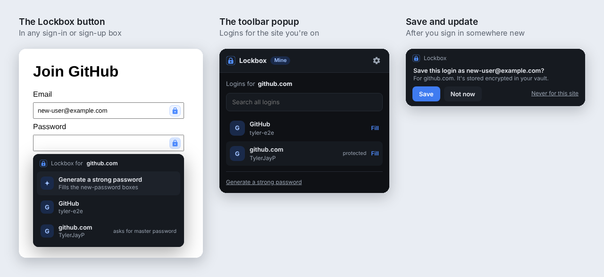

# Lockbox in your browser

The Lockbox extension fills your logins on websites, offers to save new and changed passwords, and makes strong passwords on sign-up pages. It works with **Chrome, Edge, Brave and Firefox**.

It talks only to the Lockbox app on the same computer. It has no account, no server and no copy of your vault, so on its own it can't do anything: it needs Lockbox 0.7.0 or newer, running and unlocked.

<p align="center">
  
</p>

## Set it up

1. **In Lockbox,** open **Settings → Browser extension** and turn on *Let the Lockbox extension fill and save logins in my browser*.
2. **Add the extension** to your browser (below).
3. **Connect it.** Click the Lockbox icon in the toolbar (if you don't see it, click the puzzle-piece icon and pin Lockbox), then **Connect**. Lockbox asks *"Connect Google Chrome to Lockbox?"* (or Edge, Brave, Firefox) and shows a six-digit code. If it's the same code as in the popup, click **Allow**. You only do this once per browser.

### Adding the extension to Chrome, Edge or Brave

**From the Chrome Web Store:** open the Lockbox link you were given and click **Add to Chrome** (or **Get** in Edge; Edge first asks to allow extensions from other stores).

**Without the store:**

1. Download `Lockbox-Browser-Extension-<version>.zip` from the [latest release](https://github.com/TylerJayP/Lockbox/releases/latest).
2. Extract it to a folder you'll keep, like `Documents\Lockbox extension`. The browser loads the extension from that folder, so don't delete it.
3. Open `chrome://extensions` (`edge://extensions` in Edge, `brave://extensions` in Brave) and turn on **Developer mode**.
4. Click **Load unpacked** and choose the folder.

To update, extract the new zip over the same folder and click the reload arrow on the Lockbox card in the extensions page.

### Adding the extension to Firefox

Firefox only keeps add-ons that Mozilla has signed. Install Lockbox from its addons.mozilla.org page, or, if you were sent a `.xpi` file, open `about:addons`, click the gear icon and choose **Install Add-on From File**.

If Firefox ever says Lockbox can't reach websites (you can switch that off per add-on in Firefox), the popup shows **Allow Lockbox on websites**. Click **Allow**.

## Using it

- **The Lockbox button.** Sign-in boxes get a small lock button on their right edge. Click it and pick a login. It only lists logins saved for the site you're on.
- **The toolbar popup** lists the logins for the current site, with **Fill** next to each. Search finds any login in your vault.
- **Ctrl+Shift+L** fills straight away when the site has exactly one login, and opens the popup when there's more than one. Change the shortcut at `chrome://extensions/shortcuts`, or in Firefox under `about:addons` → gear icon → *Manage Extension Shortcuts*.
- **Sign-up pages.** In a new-password box, the lock button offers **Generate a strong password**, which fills the password and confirm boxes with the same 20-character password. You can also generate one from the popup.
- **Saving.** After you sign in with a login Lockbox doesn't have, or with a changed password, a bar offers **Save** or **Update**. Nothing is saved until you click. Updating keeps the old password in the item's history. Sites that sign in over two pages (username first, password next) work too. *Never for this site* stops the offers on that site.
- **Protected items** ask for your master password in the Lockbox window before they fill.
- **When Lockbox is locked,** the popup and the lock button say so. *Unlock Lockbox* brings the window forward.

The gear icon in the popup turns the lock buttons or the save offers off, and lists the sites you chose *Never for this site* on.

**To disconnect a browser,** open **Settings → Browser extension** in Lockbox and click **Disconnect** next to it. Turning the setting off disconnects every browser and removes Lockbox's registration from them.

## How it keeps your passwords safe

- **Nothing leaves your computer.** The browser starts a small helper that ships with Lockbox (`Lockbox.BrowserHost.exe`), using the browser's standard *native messaging*. The helper passes messages to Lockbox over a local channel that only your Windows account can open. There is no network connection anywhere in this.
- **Only Lockbox's own extension gets in.** Browsers only start the helper for the extension IDs Lockbox registered, and Lockbox checks the ID again on every message. Each browser also has to be approved once in Lockbox, with a matching code.
- **Look-alike sites get nothing.** Lockbox matches logins by real site, using the [Public Suffix List](https://publicsuffix.org): `github.com.evil.net` is the site *evil.net*, not GitHub, and `alice.github.io` and `bob.github.io` are different sites. A look-alike page shows no logins, and filling a login on a different site needs you to click past a warning (where *Cancel* is the default).
- **Passwords only travel when you pick a login.** Lists of logins never include passwords. When you fill, the password goes only into the part of the page on the right site, not into frames from other sites embedded in it.
- **Websites can't drive the extension.** The menu and the save bar are the extension's own pages, which a website can't read or click for you. Fills only happen from your real clicks and key presses.
- **Saving can't overwrite other sites' logins.** Save and Update only ever touch logins for the site you're on.

What it can't protect against: once a password is filled into a page, that page has it (the site needs it to sign you in). Malware on your computer, or another browser extension allowed to read every site, can see what's typed or filled on a page. That's true of every password manager's extension. If you don't use the extension, leave the setting off.

### Privacy

The Lockbox extension doesn't collect, send or sell any data. It reads the sign-in forms on pages you visit so it can fill and save logins, and passes logins only between the page and the Lockbox app on the same computer. Its settings (whether to show the lock buttons, whether to offer saving, and sites you chose never to save on) stay in your browser.

---

## Publishing the extension

*For whoever releases Lockbox.*

```
dotnet run --project tools/Lockbox.Release -- extension
```

That makes three packages in `Releases/extension`. The version comes from `"version"` in `extension/manifest.json`; raise it whenever the extension changes.

| File | For |
|---|---|
| `Lockbox-Browser-Extension-<version>.zip` | *Load unpacked* in Chrome, Edge and Brave. It keeps the development key, so it has the ID Lockbox already trusts. Every `release` attaches it to the GitHub release too. |
| `lockbox-extension-chrome-web-store-<version>.zip` | Uploading to the Chrome Web Store (and Microsoft Edge Add-ons). |
| `lockbox-extension-firefox-<version>.zip` | Uploading to addons.mozilla.org. |

### Chrome Web Store (Chrome, Edge and Brave)

1. Sign up in the [Chrome Web Store Developer Dashboard](https://chrome.google.com/webstore/devconsole). There's a one-time $5 registration fee.
2. Click **New item** and upload the Chrome Web Store zip. The dashboard shows the item's **ID** (32 letters) straight away.
3. **Tell Lockbox about that ID before publishing.** The store gives the extension its own ID, and Lockbox only answers IDs it knows. Add it to `ChromeExtensionIds` in [`src/Lockbox.Core/Web/BrowserBridge.cs`](../src/Lockbox.Core/Web/BrowserBridge.cs) and release a new Lockbox.
4. Fill in the listing:
   - **Privacy:** single purpose "Fill and save logins from the Lockbox password manager on this computer". Permission reasons: *nativeMessaging* talks to the Lockbox app, *scripting* and *host permissions* find sign-in forms and fill them, *storage* keeps the extension's settings, *activeTab* fills the current tab from the toolbar. For the privacy policy, link to the [Privacy](#privacy) section above. Answer the data questions to match it: logins pass only between the page and the Lockbox app on the same computer.
   - **Visibility:** *Unlisted* lets anyone with the link install it, without it showing up in search. *Private* limits it to the Google accounts you list as trusted testers.
5. Submit for review (usually a few days).

To update, raise the version, run the `extension` command, and upload the new zip on the item's **Package** page. The store updates everyone's copy by itself.

Edge users can install straight from the Chrome Web Store. You can also list it on [Microsoft Edge Add-ons](https://partner.microsoft.com/dashboard/microsoftedge/) (free) with the same zip; that listing gets its own ID, which also goes in `ChromeExtensionIds`.

### Firefox (addons.mozilla.org)

1. Sign in to the [Add-on Developer Hub](https://addons.mozilla.org/developers/) and click **Submit a New Add-on**.
2. Choose where it's distributed:
   - **On this site** lists it on addons.mozilla.org. Mozilla reviews it, and Firefox updates everyone's copy by itself. Listing it publicly is harmless, since it does nothing without Lockbox.
   - **On your own** gets it signed without a listing. You download the signed `.xpi` from the Developer Hub and share it; people install it with *Install Add-on From File*. Each new version has to be shared the same way.
3. Upload the Firefox zip. When asked about source code, the extension isn't minified or bundled, so none is needed.

The Firefox add-on ID is fixed (`lockbox@tylerjayp.github.io`), so Lockbox already trusts it.

To try an unsigned build, open `about:debugging` → *This Firefox* → **Load Temporary Add-on** and pick `manifest.json` from the extracted Firefox zip. It's removed when Firefox closes.
